<!-- ========== PALETA GLIMMER ==========
primary:      #A6586D  (rosa oscuro)
accent:       #BF658F  (magenta suave)
mint:         #BDF2D4  (menta)
rose:         #F2CEDB  (rosa claro)
beige:        #D9C8A9  (beige suave)
text-dim:     #6F4D58  (texto secundario)

NOTA: GitHub elimina los atributos style="" y las etiquetas <style> de los
README. Los colores solo funcionan dentro de imágenes/SVG (assets/) y badges.
====================================== -->

 

 

<h2 align="center">✦ About me ✦</h2>

| | |
|:--|:--|
| 🎓 **Studying** | Computer Systems Engineering |
| 🌱 **Learning** | Docker · Supabase · AWS |
| 💬 **Let's talk about** | C# · Java · Python · Kotlin |
| 🤝 **Community** | Active in university initiatives and civic / volunteer work |
| ⚡ **Fun fact** | Game of Thrones Night's Watch cloaks are made from Ikea rugs |

Got a question or an idea? Open an <a href="https://github.com/BenjaminSM04/BenjaminSM04/issues">issue</a> — I'd love to chat.

 

<h2 align="center">✦ Tech stack ✦</h2>

<b>Languages</b> 

  

<b>Frameworks & Engines</b> 

  

<b>Databases</b> 

  

<b>Tools</b> 

  

<b>Currently learning 🌱</b> 

 

<h2 align="center">✦ My contributions ✦</h2>

  <picture>
    <source media="(prefers-color-scheme: dark)" srcset="https://raw.githubusercontent.com/BenjaminSM04/BenjaminSM04/output/github-contribution-grid-snake-dark.svg" />
    <source media="(prefers-color-scheme: light)" srcset="https://raw.githubusercontent.com/BenjaminSM04/BenjaminSM04/output/github-contribution-grid-snake.svg" />
    
  </picture>

 

<h2 align="center">✦ Stats ✦</h2>

  

 

<!--

  

-->
