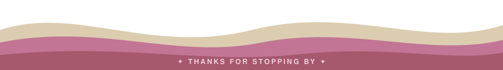

<!-- ========== PALETA GLIMMER ==========
primary:      #A6586D  (rosa oscuro)
accent:       #BF658F  (magenta suave)
mint:         #BDF2D4  (menta)
rose:         #F2CEDB  (rosa claro)
beige:        #D9C8A9  (beige suave)
text-dim:     #6F4D58  (texto secundario)

NOTA: GitHub elimina los atributos style="" y las etiquetas <style> de los
README. Los colores solo funcionan dentro de imágenes/SVG (assets/) y badges.
====================================== -->

 

 

<h2 align="center">✦ About me ✦</h2>

| | |
|:--|:--|
| 🎓 **Studying** | Computer Systems Engineering · Univalle, Bolivia |
| 🛠️ **Building** | Full-stack platforms with Vue / Nuxt, Next.js, Django and NestJS, shipped with Docker |
| 🧠 **Exploring** | LLM fine-tuning (QLoRA), transfer learning and explainable AI |
| 🥽 **Also into** | Augmented reality and game dev with Unity |
| 🤝 **Community** | Active in university initiatives and civic / volunteer work |
| ⚡ **Fun fact** | The Glimmer palette of this profile was born in my AR flashcards app — now it follows me everywhere 🎴 |

Got a question or an idea? Open an <a href="https://github.com/BenjaminSM04/BenjaminSM04/issues">issue</a> — I'd love to chat.

 

<h2 align="center">✦ Featured projects ✦</h2>

<table align="center">
  <tr>
    <td width="50%" valign="top">
      <h3><a href="https://github.com/BenjaminSM04/OnlineJudge_Deploy">🦎 LizardJudge</a></h3>
      Online judge for automatic grading of programming problems, with contests, rankings and an <b>AI tutor</b> powered by a QLoRA fine-tuned model.  
      
      
      
      
      
    </td>
    <td width="50%" valign="top">
      <h3><a href="https://github.com/BenjaminSM04/PaginaISI">🏛️ Portal Académico ISI</a></h3>
      Gamified academic portal: projects showcase, scientific articles, events / CTFs, Q&A forum, points, badges and rankings.  
      
      
      
      
      
    </td>
  </tr>
  <tr>
    <td width="50%" valign="top">
      <h3><a href="https://github.com/BenjaminSM04/Articulo_evaluacion_BusitoBusiBra">🔬 BUSI → BUS-BRA</a></h3>
      Research code: transfer learning for breast ultrasound classification across datasets, with explainability (Grad-CAM, SHAP).  
      
      
      
    </td>
    <td width="50%" valign="top">
      <h3><a href="https://github.com/BenjaminSM04/AR-Flashcards-Pronunciation">🎴 AR Flashcards</a></h3>
      Augmented reality app to practice classroom vocabulary: scan a card, tap a virtual button, hear the pronunciation.  
      
      
      
    </td>
  </tr>
</table>

 

<h2 align="center">✦ Tech stack ✦</h2>

<b>Languages</b> 

  

<b>Frontend</b> 

  

<b>Backend & Data</b> 

  

<b>AI / ML</b> 

 

  

<b>DevOps & Testing</b> 

 

  

<b>AR, Games & Mobile</b> 

 

<h2 align="center">✦ My contributions ✦</h2>

  <picture>
    <source media="(prefers-color-scheme: dark)" srcset="https://raw.githubusercontent.com/BenjaminSM04/BenjaminSM04/output/github-contribution-grid-snake-dark.svg" />
    <source media="(prefers-color-scheme: light)" srcset="https://raw.githubusercontent.com/BenjaminSM04/BenjaminSM04/output/github-contribution-grid-snake.svg" />
    
  </picture>

 

  

 

<!--

  

-->
